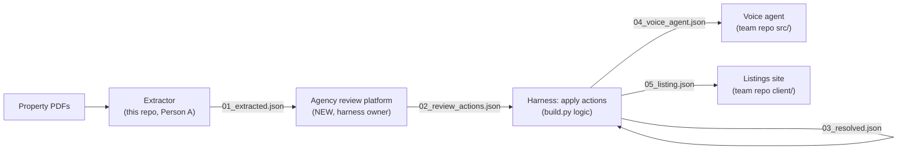
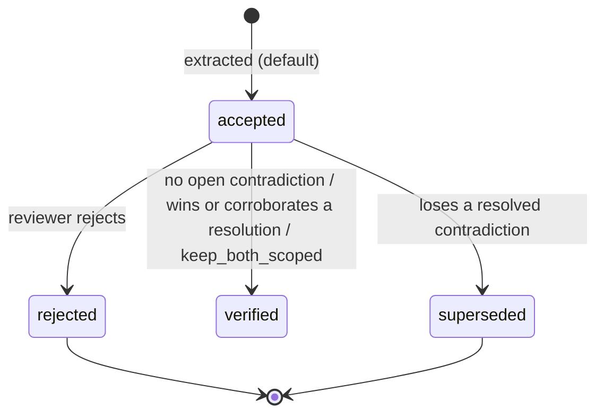
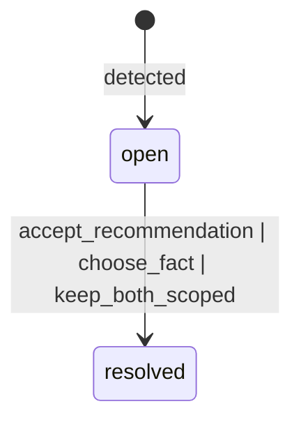

# Fact record contracts

## Two platforms

**1. Agency review platform (NEW, does not exist yet).** Used by the sales agency. They upload or see the
documents for a development, view every extracted fact with its provenance, reject facts they disagree with
(facts are accepted by default) and resolve contradictions. Its output is the set of verified facts (contract 03).

**2. Buyer-facing listings site + voice agent (EXISTING, team repo
[TYK3/Grok-Bot-Real-Estate-Hackathon](https://github.com/TYK3/Grok-Bot-Real-Estate-Hackathon): `client/` Next.js,
`src/` LiveKit agent).** It changes only slightly: it reads verified facts instead of the static
`work/hamptons_e14_2dr_lettings.json`. It consumes **04 (voice agent)** and **05 (listing)** only, and never shows
an unverified value.

| step | owner | input → output |
|---|---|---|
| Extract facts and detect contradictions | Person A (extraction, this repo: `python -m extraction run`) | PDFs → `out/*.jsonl` → **01** |
| Review: reject facts, resolve contradictions | Harness / agency review platform | **01** → **02** (append-only actions) |
| Apply actions, publish | Harness (reference implementation: `contracts/build.py`) | **01 + 02** → **03**, **04**, **05** |
| Answer buyers by voice | Voice agent team (`src/`) | **04** |
| Show listings | Listings site team (`client/`) | **05** |

**Handoff.** Plain JSON files for the hackathon. The extractor writes 01; the review platform appends actions to
02; `python3 contracts/build.py` regenerates 03/04/05; the team repo reads 04/05 from disk (or the harness serves
the same JSON at `GET /api/units/{unit_id}/voice` and `GET /api/listings`; the shape does not change).

## Lifecycle

1. **Extracted.** Every fact has a document, page, verbatim quote, date and issuer. It starts as `accepted`.
2. **Reviewed.** The agency can `reject` a fact. Contradictions start `open` with a recommended fact (authority
   tier, then recency) and a reason.
3. **Resolved.** For each contradiction the reviewer chooses one of three outcomes:
   - `accept_recommendation`;
   - `choose_fact` (any member fact);
   - `keep_both_scoped` (for scope differences and different measurement bases).

   Winners and facts with the same value become `verified`. The others become `superseded` and are kept for audit,
   never published.
4. **Verified.** Accepted facts that are in no open contradiction become `verified`. Facts still in an open
   contradiction stay `accepted` with `blocked_by_open_contradiction: true`.
5. **Published.** The voice agent gets verified statements with citations (04). Open contradictions appear only as
   `do_not_state` entries with safe phrasing. The listing (05) shows verified values; a field touched by an open
   contradiction shows "Pending verification" and has no value.

## Files

| file | what |
|---|---|
| `01_extracted.json` | per development: documents, facts (status `accepted`), contradictions C01–C11 (+ D01–D03 extra real detections), status `open` |
| `02_review_actions.json` | action shapes + the demo actions: 1 fact rejection, resolutions for C01–C11 (D01–D03 left open on purpose) |
| `03_resolved.json` | 01 after 02, with each fact's `history`; `before_after` shows C01 (Kelso price) and C06 (parking 6 vs 5) |
| `04_voice_agent.json` | per unit: `statements` (verified only, with citation) and `do_not_state` (open contradictions + safe phrasing) |
| `05_listing.json` | per listing unit: `fields` (value, display, fact_id, verification_status, citation) and `property` in the team catalogue shape |
| `build.py` | regenerates 01 from `out/` and 03/04/05 from 01 + 02 (`--reseed` rewrites the demo 02) |

All values come from a real run of the pipeline on `sample_data/`; `out/facts.jsonl` and `out/contradictions.jsonl`
are committed alongside.

## Small adjustments in the team repo (not made yet)

- `src/properties.py`: point `PROPERTY_DATA_PATH` at a catalogue built from `05_listing.json`
  (`listings[*].property`, which already uses the same keys as `work/hamptons_e14_2dr_lettings.json`), and load
  `04_voice_agent.json` keyed by `reference` (= `unit_id`).
- `src/properties.py` `format_property_details()`: render only `statements[*].say` (with `citation` available for
  "where does that come from?"), then a "DO NOT STATE" block listing each `do_not_state[*].safe_phrasing`.
- `src/prompts/v2.md` (loaded in `src/agent.py`): add the rule "Only quote facts from PROPERTY DETAILS; cite the
  document and page when asked; for anything under DO NOT STATE use the given phrasing, never a number."
- `client/src/lib/properties.ts`: read the 05-derived catalogue instead of `hamptons_e14_2dr_lettings.json`.
- `client/src/lib/property-types.ts`: add optional `fact_provenance` and `verification_status` maps.
- `client/src/app/property/[id]/page.tsx` and `client/src/components/PropertyCard.tsx`: when
  `verification_status[field] === "pending_verification"`, show "Pending verification" instead of the value
  (`priceLabel` in `client/src/lib/format.ts` should do this for price).
